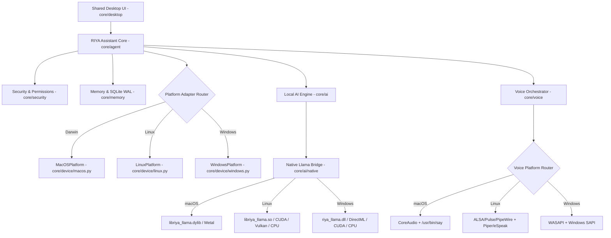

# RIYA v1.0 — Cross-Platform Architecture Specification
## Unified Abstraction Model for macOS, Linux, and Windows

**Date:** 2026-11-15  
**Developer:** Tukaram  
**Product:** RIYA — Universal Personal AI Assistant  
**Status:** Milestone 5.1 Architecture Formalization  

---

## 1. Architectural Philosophy

RIYA's architecture adheres strictly to the **Single Core, Native Adapters** principle:
- **Shared Intelligence Core:** 100% of reasoning, memory retrieval, task decomposition, conversation state management, cryptographic security policies, tool arbitration, and local neural network orchestration reside in shared, platform-agnostic modules (`core/ai/`, `core/agent/`, `core/memory/`, `core/security/`, `core/desktop/`).
- **Platform-Specific Adapters:** Low-level hardware access, operating system APIs, window management, audio drivers, process lifecycles, and notification servers reside strictly inside isolated platform adapters (`core/device/`, `core/voice/adapters.py`).
- **Zero Business Logic Duplication:** An action such as "Remember user preference" or "Plan file organization task" executes identical Python code regardless of whether the host OS is macOS Sonoma, Ubuntu 24.04 LTS, or Windows 11 Pro.



---

## 2. Directory Layout & Module Responsibilities

```text
core/
├── device/                          # Platform Abstraction Layer
│   ├── __init__.py                  # Global registry & get_platform_adapter() resolver
│   ├── platform.py                  # Core contracts: PlatformAdapter, PlatformInfo, Capabilities
│   ├── base.py                      # Common helper routines (psutil, subprocess, fallback guards)
│   ├── macos.py                     # Native macOS adapter (LaunchServices, AppleScript, Quartz)
│   ├── linux.py                     # Native Linux adapter (XDG, .desktop, xdotool, notify-send)
│   └── windows.py                   # Native Windows adapter (Win32, PowerShell, Toast, Start Menu)
├── voice/                           # Cross-Platform Voice Engine
│   ├── adapters.py                  # AudioInputAdapter, AudioOutputAdapter, STT/TTS contracts
│   ├── audio_input.py               # Low-latency PortAudio stream capture (sounddevice)
│   ├── audio_output.py              # Chunked interruptible audio playback
│   ├── stt.py                       # CTranslate2 / faster-whisper local transcription
│   ├── tts.py                       # Multi-platform local TTS factory (/usr/bin/say, piper, SAPI)
│   └── orchestrator.py              # Streaming conversational state machine
├── ai/                              # Local Neural Inference Architecture
│   ├── local_runtime.py             # High-level offline runtime with metrics & reload avoidance
│   ├── native/
│   │   ├── llama_runtime.py         # ctypes bridge wrapper with dynamic library resolution
│   │   └── bridge/
│   │       ├── riya_llama.cpp       # Native C++ llama.cpp bridge source
│   │       ├── libriya_llama.dylib  # macOS arm64 shared library
│   │       ├── libriya_llama.so     # Linux shared library target
│   │       └── riya_llama.dll       # Windows DLL target
│   └── provisioning/
│       ├── catalog.py               # Verified GGUF model registry
│       ├── hardware.py              # Multi-platform CPU/GPU/RAM detection
│       └── downloader.py            # Resumable HTTPS streaming downloader
├── config/
│   ├── paths.py                     # Standardized path resolver (XDG, AppData, Application Support)
│   └── settings.py                  # Global application settings & allowed filesystem roots
└── tools/
    └── system/                      # Operating System Toolkits
        ├── base.py                  # Cross-platform validation & secret scrubbing
        ├── macos.py                 # macOS specific shell commands
        ├── linux.py                 # Linux specific shell commands
        ├── windows.py               # Windows specific PowerShell / cmd commands
        └── terminal.py              # Safe sandboxed command execution
```

---

## 3. Core Interface Specifications

### 3.1 Unified Platform Adapter (`PlatformAdapter`)

Every operating system adapter exposes the standardized interface defined in [core/device/platform.py](file:///Users/tukaramgore/Projects/RIYA/core/device/platform.py):

```python
class PlatformAdapter(ABC):
    platform_name: str  # "macos" | "linux" | "windows"

    @property
    @abstractmethod
    def system_info_adapter(self) -> SystemInformationAdapter: ...

    @property
    @abstractmethod
    def application_adapter(self) -> ApplicationAdapter: ...

    @property
    @abstractmethod
    def filesystem_adapter(self) -> FilesystemAdapter: ...

    @property
    @abstractmethod
    def clipboard_adapter(self) -> ClipboardAdapter: ...

    @property
    @abstractmethod
    def notification_adapter(self) -> NotificationAdapter: ...

    @property
    @abstractmethod
    def window_adapter(self) -> WindowManagerAdapter: ...

    @abstractmethod
    def platform_info(self) -> PlatformInfo: ...

    @abstractmethod
    def capabilities(self) -> PlatformCapabilities: ...
```

### 3.2 Operating System Sub-Adapters

1. **`SystemInformationAdapter`:**
   - `get_system_info()`: CPU brand, architecture, logical/physical cores, uptime.
   - `get_storage_info(path)`: Total, used, free disk bytes and mount points.
   - `get_battery_status()`: Charge percentage, AC connected, power saving mode.
   - `get_network_status()`: Active interfaces, IP addresses, connectivity state.
2. **`ApplicationAdapter`:**
   - `discover_applications()`: Enumerates installed applications (macOS bundles, Linux `.desktop` files, Windows Start Menu shortcuts).
   - `launch_application(name)`: Launches application without elevated privileges.
   - `close_application(name)`: Gracefully closes application window.
   - `terminate_application(name)`: Confirmed force-kill of stuck process.
   - `list_running_applications()`: Active GUI applications.
   - `get_application_resources(name)`: CPU% and RSS memory MB usage.
3. **`ClipboardAdapter`:**
   - `read_clipboard()`: Sanitized text contents with secret-scrubbing.
   - `write_clipboard(text)`: Replaces clipboard contents.
4. **`NotificationAdapter`:**
   - `send_notification(title, message, subtitle)`: Dispatches native desktop notification.
5. **`WindowManagerAdapter`:**
   - `get_active_window_info()`: Title, process name, and geometry of frontmost window.
   - `focus_application(name)`: Brings application to foreground.
   - `get_application_state(name)`: `"not_running"` | `"running"` | `"frontmost"`.

---

## 4. Cross-Platform Voice Engine Model

Voice interaction relies on three modular abstraction layers:

1. **Audio Hardware Layer ([core/voice/audio_input.py](file:///Users/tukaramgore/Projects/RIYA/core/voice/audio_input.py) & [core/voice/audio_output.py](file:///Users/tukaramgore/Projects/RIYA/core/voice/audio_output.py)):**
   - Built on `sounddevice` / PortAudio, which supports CoreAudio (macOS), ALSA / PulseAudio / PipeWire (Linux), and WASAPI (Windows).
   - Standardizes capture on 16 kHz mono float32 audio arrays with Silero VAD (ONNX Runtime).
2. **Speech Recognition Layer ([core/voice/stt.py](file:///Users/tukaramgore/Projects/RIYA/core/voice/stt.py)):**
   - Built on `faster-whisper` (CTranslate2).
   - Utilizes CPU INT8 vector quantization out-of-the-box on x86_64 and arm64, with automated CUDA offload on systems equipped with NVIDIA GPUs.
3. **Speech Synthesis Layer ([core/voice/tts.py](file:///Users/tukaramgore/Projects/RIYA/core/voice/tts.py)):**
   - Dispatches through a platform factory:
     - **macOS:** `/usr/bin/say` (native system voices).
     - **Linux:** Local neural `piper-tts` or lightweight `espeak-ng` / `spd-say`.
     - **Windows:** Native Windows SAPI speech synthesis via `System.Speech.Synthesis`.

---

## 5. Cross-Platform Local AI Inference Engine

The local neural inference bridge ([core/ai/native/llama_runtime.py](file:///Users/tukaramgore/Projects/RIYA/core/ai/native/llama_runtime.py)) dynamically selects libraries and backends:

```python
def resolve_bridge_library() -> Path:
    bridge_dir = Path(__file__).resolve().parent / "bridge"
    if sys.platform == "darwin":
        return bridge_dir / "libriya_llama.dylib"
    elif sys.platform == "win32":
        return bridge_dir / "riya_llama.dll"
    else:
        return bridge_dir / "libriya_llama.so"

def resolve_supported_backends() -> list[str]:
    backends = ["auto", "cpu"]
    if sys.platform == "darwin" and platform.machine() in {"arm64", "aarch64"}:
        backends.append("metal")
    elif sys.platform in {"linux", "win32"}:
        if has_nvidia_cuda():
            backends.append("cuda")
        if has_vulkan():
            backends.append("vulkan")
        if sys.platform == "win32" and has_directml():
            backends.append("directml")
    return backends
```

---

## 6. Standardized File & Path Isolation

Path resolution ([core/config/paths.py](file:///Users/tukaramgore/Projects/RIYA/core/config/paths.py)) guarantees clean separation between immutable binaries and mutable user data across all three platforms:

```text
macOS:
  User Data:     ~/Library/Application Support/RIYA/data/riya.db
  Models:        ~/Library/Application Support/RIYA/models/
  Logs:          ~/Library/Logs/RIYA/
  Cache:         ~/Library/Caches/RIYA/

Linux:
  User Data:     $XDG_DATA_HOME/riya/data/riya.db (default: ~/.local/share/riya/data/riya.db)
  Models:        $XDG_DATA_HOME/riya/models/
  Logs:          $XDG_STATE_HOME/riya/logs/ (default: ~/.local/state/riya/logs/)
  Cache:         $XDG_CACHE_HOME/riya/ (default: ~/.cache/riya/)

Windows:
  User Data:     %APPDATA%\RIYA\data\riya.db
  Models:        %APPDATA%\RIYA\models\
  Logs:          %LOCALAPPDATA%\RIYA\logs\
  Cache:         %LOCALAPPDATA%\RIYA\cache\
```

---

## 7. Next Steps & Approval Gate

With Milestone 5.1 audit and architecture complete, we await approval to begin implementation in order:
1. **Milestone 5.2:** Linux OS integration & audio.
2. **Milestone 5.3:** Linux packaging (AppImage & `.deb`).
3. **Milestone 5.4:** Windows OS integration & audio.
4. **Milestone 5.5:** Windows packaging (Installer).
5. **Milestone 5.6:** Cross-platform AI hardware acceleration.
6. **Milestone 5.7:** Shared UI, security, and user data verification.
7. **Milestone 5.8:** Full cross-platform regression & installation verification.

