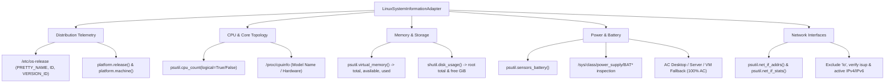
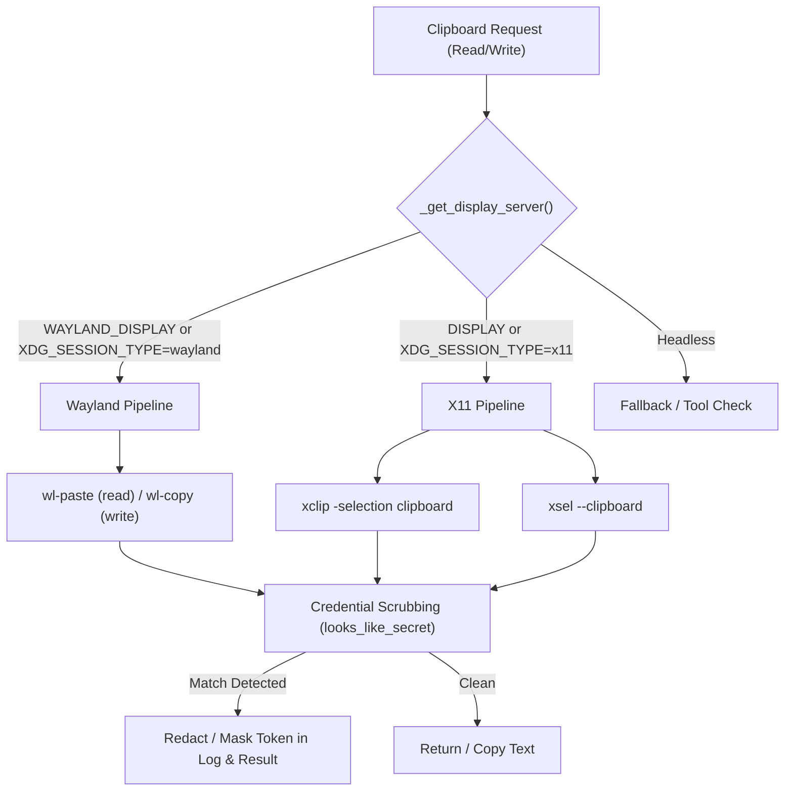

# RIYA v1.0 — LINUX DEVICE INTEGRATION REPORT
## Comprehensive OS Services, XDG Standards, and Hardware Adapters

**Developer:** Tukaram  
**Architecture:** Linux Platform Adapter Subsystem  
**Reference Target:** Ubuntu 24.04 LTS (x86_64 and aarch64)  
**Specification:** Freedesktop.org XDG Base Directory & Desktop Entry Spec  
**Source Code:** [core/device/linux.py](file:///Users/tukaramgore/Projects/RIYA/core/device/linux.py)

---

## 1. System Information & Telemetry (`LinuxSystemInformationAdapter`)

The Linux system information adapter provides low-overhead, offline inspection of host distribution, kernel, hardware resources, power supply, and network state.

### 1.1 Distribution & Kernel Identification
- Parses `/etc/os-release` (and `/usr/lib/os-release` fallback) strictly adhering to the Freedesktop specification.
- Extracts `PRETTY_NAME`, `NAME`, `ID`, and `VERSION_ID` without shell execution.
- Gathers kernel release and hardware machine architecture via standard Python `platform.release()` and `platform.machine()`.

### 1.2 CPU & Memory Telemetry
- Inspects physical and logical CPU core counts via `psutil.cpu_count()`.
- Extracts model name directly from `/proc/cpuinfo` (e.g., `Intel(R) Core(TM)`, `AMD Ryzen`, or ARM processor branding).
- Evaluates memory metrics in GiB using `psutil.virtual_memory()`.

### 1.3 Storage & Battery Status
- Calculates disk space using `shutil.disk_usage()`, returning available GiB, total GiB, and utilization percentage.
- Inspects battery status via `psutil.sensors_battery()` or direct sysfs queries in `/sys/class/power_supply/`.
- Gracefully identifies desktop workstations, cloud VMs, and containerized environments where no physical battery exists, returning `has_battery=False` with status `"Connected to AC power"`.

### 1.4 Network Interface Inspection
- Queries active non-loopback network interfaces using `psutil.net_if_addrs()` and `psutil.net_if_stats()`.
- Verifies interface `is_up` status and IPv4/IPv6 addresses, truthfully reporting offline status when no active external connection exists.

---

## 2. Application Discovery & Process Management (`LinuxApplicationAdapter`)

Application management on Linux follows the XDG Desktop Entry Specification to discover installed GUI software, resolve binaries, launch applications securely, and safely terminate running processes.

### 2.1 XDG Desktop Entry Discovery
Applications are discovered by scanning the following standard directory hierarchy:
1. `~/.local/share/applications` (User-specific applications)
2. `/usr/local/share/applications` (Locally installed admin applications)
3. `/usr/share/applications` (System distribution applications)
4. `/var/lib/flatpak/exports/share/applications` (System Flatpak bundles)
5. `~/.local/share/flatpak/exports/share/applications` (User Flatpak bundles)
6. `/var/lib/snapd/desktop/applications` (Snap packages)

### 2.2 Desktop File Parsing & Exec Cleaning
- Uses Python `configparser` with `strict=False` and `interpolation=None` to parse `[Desktop Entry]`.
- Filters out entries with `NoDisplay=true` or `Type` != `Application`.
- Cleans the `Exec` field by stripping XDG field codes (`%f`, `%F`, `%u`, `%U`, `%d`, `%i`, `%c`, `%k`, `%v`, `%m`) via regex `re.sub(r"%[a-zA-Z]", "", exec_field)`.
- Tokenizes commands into parameter arrays to avoid shell expansion.

### 2.3 Safe Application Launching
- Checks executable existence on system `PATH` via `shutil.which()` or absolute path validation.
- Launches processes using `subprocess.Popen(cmd_array, shell=False, stdout=subprocess.DEVNULL, stderr=subprocess.DEVNULL, start_new_session=True)`.
- Never invokes `sh` or `bash` or `shell=True`.

### 2.4 Critical Process Safeguards
To preserve OS and desktop environment stability, RIYA implements hardcoded process safeguards:
- **Protected Processes:** `systemd`, `init`, `kthreadd`, `kworker`, `systemd-journald`, `systemd-udevd`, `systemd-logind`, `systemd-resolved`, `xorg`, `xwayland`, `mutter`, `kwin`, `sway`, `weston`, `gnome-shell`, `dbus-daemon`, `dbus-broker`, `pulseaudio`, `pipewire`, `wireplumber`, `riya`, `sshd`, `login`.
- **Protected PIDs:** PID 1, PID 2, and RIYA's own current PID / parent PID cannot be terminated under any circumstances.
- Attempts to terminate any protected process return `status="denied"` with an explicit security explanation.
- For legitimate non-protected processes, graceful `terminate()` (SIGTERM) is used first, with `kill()` (SIGKILL) reserved only for explicit force requests.

---

## 3. Filesystem Sandboxing (`LinuxFilesystemAdapter`)

The Linux filesystem adapter enforces the same strict sandboxing rules as the macOS implementation:
- **Allowed Roots:** Confines all file discovery and inspection to `FILESYSTEM_ALLOWED_ROOTS` (project root, user data directory, Desktop, Documents, Downloads, /tmp).
- **Symlink Protection:** Directory scans filter out symlinks (`if not f.is_symlink()`) to prevent symlink traversal outside authorized boundaries.
- **Path Resolution:** All paths are resolved to their canonical realpaths (`Path(p).resolve()`) prior to evaluation.

---

## 4. Clipboard Operations & Display Server Awareness (`LinuxClipboardAdapter`)

Linux desktop environments are split between modern Wayland compositors and legacy X11 servers. `LinuxClipboardAdapter` detects the active display server dynamically:

### 4.1 Wayland vs X11 Tool Selection
- **Wayland:** Prefers `wl-paste` (read) and `wl-copy` (write) from `wl-clipboard`.
- **X11:** Prefers `xclip` (`-selection clipboard`), falling back to `xsel` (`--clipboard`).
- If neither tool is installed on the host, the adapter returns `status="unavailable"` with clear package installation instructions.

### 4.2 Sensitive Credential Scrubbing
- All clipboard read and write payloads are scanned using `looks_like_secret()`.
- Strings matching API keys (`sk-...`), Bearer tokens, passwords, or secrets are redacted from output messages and previews to prevent token leakage.

---

## 5. Local Desktop Notifications (`LinuxNotificationAdapter`)

- Generates desktop notifications using the Freedesktop `notify-send` standard utility (`libnotify-bin`).
- Passes arguments strictly as parameter arrays: `[notify_send, "-a", "RIYA", title, message]`.
- Handles subtitles cleanly by formatting the header as `f"{title} - {subtitle}"`.
- Gracefully reports `status="unavailable"` when `notify-send` is not installed on the system.

---

## 6. Window Inspection & Wayland Security Boundaries (`LinuxWindowManagerAdapter`)

- **Wayland Environment:** Under Wayland, security isolation between client windows is an architectural principle. Non-privileged clients are prohibited from querying or manipulating other windows. The adapter truthfully reports `status="success", restricted=True` with the message:  
  `"Window inspection is restricted under Wayland display server for client security isolation."`
- **X11 Environment:** Queries active window IDs and titles using `xdotool getactivewindow getwindowname` or `wmctrl -lx`.

