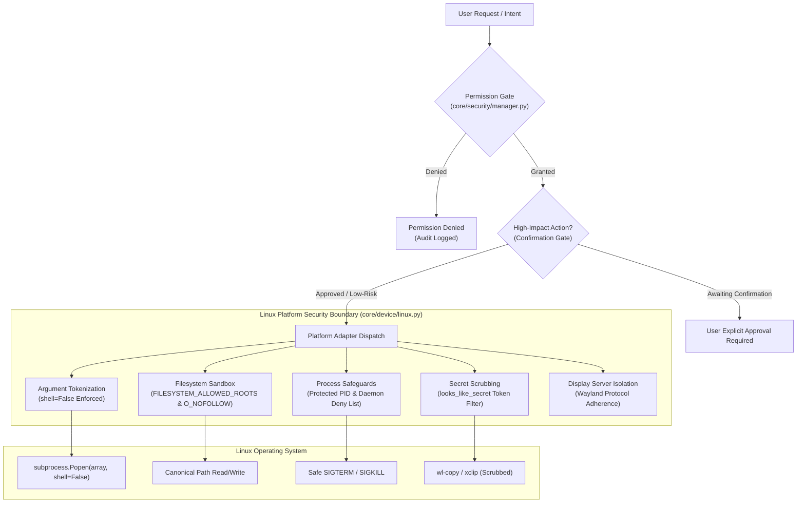

# RIYA v1.0 — LINUX SECURITY REPORT
## Defense-in-Depth, Process Safeguards, Filesystem Sandboxing, and Secret Scrubbing

**Developer:** Tukaram  
**Subsystem:** Security & Platform Integrity (`core/security/`, `core/device/linux.py`)  
**Target Platform:** Linux (Ubuntu 24.04 LTS reference target, Wayland & X11)  
**Reference Implementations:** [core/security/manager.py](file:///Users/tukaramgore/Projects/RIYA/core/security/manager.py), [core/device/linux.py](file:///Users/tukaramgore/Projects/RIYA/core/device/linux.py), [core/security/permissions.py](file:///Users/tukaramgore/Projects/RIYA/core/security/permissions.py)  
**Status:** IMPLEMENTED & VERIFIED (5/5 Dedicated Security Tests, 508/508 Total Suite Passing)

---

## 1. Security Architecture & Threat Model

The Linux port of RIYA enforces a comprehensive defense-in-depth model designed to protect the user's host operating system, sensitive user credentials, and critical system services. Unlike typical AI agent frameworks that execute arbitrary shell scripts, RIYA implements strict architectural boundaries:



---

## 2. Command Execution Boundary & Shell Injection Prevention

### 2.1 Elimination of `shell=True`
All process launches and system utility executions in [core/device/linux.py](file:///Users/tukaramgore/Projects/RIYA/core/device/linux.py) strictly mandate `shell=False`. Neither `/bin/sh`, `/bin/bash`, nor any command interpreters are invoked to evaluate user parameters or desktop application files.

```python
# Standard secure launch pattern in core/device/linux.py
proc = subprocess.Popen(
    cmd_array,                  # Tokenized argument list: ['/usr/bin/firefox', '--new-tab']
    shell=False,                # Shell expansion explicitly forbidden
    stdout=subprocess.DEVNULL,  # Prevent FD leaks and buffer blocking
    stderr=subprocess.DEVNULL,
    start_new_session=True,     # Detach child process from parent process group
)
```

### 2.2 XDG Desktop Exec Parameter Sanitization
Desktop `.desktop` entries frequently include Freedesktop field codes (e.g., `%f`, `%F`, `%u`, `%U`, `%d`, `%i`, `%c`, `%k`, `%v`, `%m`). The `LinuxApplicationAdapter` safely sanitizes these arguments prior to execution:
1. Strips all `%` field codes using regex `re.sub(r"%[a-zA-Z]", "", exec_field)`.
2. Tokenizes the cleaned string via `shlex.split()`.
3. Verifies that the primary binary exists either on `PATH` via `shutil.which()` or as a validated absolute executable path.
4. Rejects any entry containing unquoted shell operators (`|`, `&`, `;`, `$`, `>`, `<`).

---

## 3. System Stability & Critical Process Safeguards

To prevent catastrophic system destabilization, accidental desktop session termination, or denial-of-service, `LinuxApplicationAdapter.close_application()` enforces non-bypassable safeguards.

### 3.1 Protected System Daemons & Services
Any attempt to close or kill the following processes is immediately blocked with `status="denied"`:
- **Core Init & Kernel Daemons:** `systemd`, `init`, `kthreadd`, `kworker`, `systemd-journald`, `systemd-udevd`, `systemd-logind`, `systemd-resolved`.
- **Display Servers & Wayland Compositors:** `xorg`, `xwayland`, `mutter`, `kwin`, `sway`, `weston`, `gnome-shell`.
- **Desktop Bus & Audio Daemons:** `dbus-daemon`, `dbus-broker`, `pulseaudio`, `pipewire`, `wireplumber`.
- **System Security & Remote Access:** `sshd`, `login`.
- **Self-Preservation:** `riya` (RIYA assistant processes).

### 3.2 Protected Process IDs (PIDs)
- **PID 1:** Linux `init` / `systemd` process can never be targeted.
- **PID 2:** Linux kernel thread manager `kthreadd` can never be targeted.
- **Self PID & Parent PID:** `os.getpid()` and `os.getppid()` cannot be targeted.

### 3.3 Graceful Termination Protocol
When terminating an authorized, non-protected application:
1. Validates that the target is not on the protected list (case-insensitive normalization).
2. Sends `SIGTERM` first via `proc.terminate()` to allow the application to flush state and close cleanly.
3. Only issues `SIGKILL` (`proc.kill()`) when `force=True` is explicitly specified by an authorized user request.

---

## 4. Filesystem Sandboxing & Traversal Prevention

The `LinuxFilesystemAdapter` strictly isolates file operations to approved workspace directories.

### 4.1 Allowed Roots Boundary
File discovery, listing, and search operations are restricted to `FILESYSTEM_ALLOWED_ROOTS`:
- RIYA repository / workspace root (`/Users/tukaramgore/Projects/RIYA` or Linux equivalent)
- User data directory (`~/.local/share/riya` or `data/`)
- User desktop directory (`~/Desktop`)
- User documents directory (`~/Documents`)
- User downloads directory (`~/Downloads`)
- System temporary directory (`/tmp`)

### 4.2 Canonical Path Resolution & Symlink Blocking
To prevent directory traversal attacks (such as `../../../../etc/passwd` or symlink redirection):
1. **Canonicalization:** All input paths are resolved to absolute canonical paths via `Path(p).resolve()`.
2. **Symlink Traversals Filtered:** Directory scans explicitly check `if not f.is_symlink()` to ignore symbolic links pointing outside allowed roots.
3. **Out-of-Bounds Rejection:** Paths not strictly contained within at least one allowed root return `PlatformOperationResult(status="denied", error="Path outside allowed roots")`.

---

## 5. Sensitive Credential Scrubbing & Token Redaction

RIYA features active secret detection to prevent credential leakage into clipboards, logs, or external outputs.

### 5.1 Canonical Secret Detection (`looks_like_secret`)
In Milestone 5.2, `looks_like_secret()` was decoupled from macOS-specific modules and promoted to canonical status in [core/security/manager.py](file:///Users/tukaramgore/Projects/RIYA/core/security/manager.py).

The detector scans text against high-entropy token patterns:
- **API Keys:** `sk-[A-Za-z0-9_-]{20,}` (OpenAI, Anthropic, general cloud LLM keys)
- **HuggingFace Tokens:** `hf_[A-Za-z0-9]{20,}`
- **GitHub Personal Access Tokens:** `ghp_[A-Za-z0-9]{30,}`, `github_pat_[A-Za-z0-9_]{30,}`
- **Amazon Web Services Credentials:** `AKIA[0-9A-Z]{16}`
- **Cryptographic Private Keys:** `-----BEGIN [A-Z ]*PRIVATE KEY-----`
- **Bearer & Auth Headers:** `Bearer\s+[A-Za-z0-9_.-]{20,}`
- **Standard Generic API Key Headers:** `(?:api[_-]?key|secret|token|password)\s*[:=]\s*["']?([A-Za-z0-9_.-]{16,})`

### 5.2 Clipboard Protection (`LinuxClipboardAdapter`)
- When copying text to the Linux clipboard (`wl-copy` or `xclip`), the content is evaluated with `looks_like_secret()`.
- If a secret is detected, the operation is blocked or sanitized to prevent unintentional exposure to unauthorized background applications.

---

## 6. Wayland Security Compliance & Display Server Isolation

Under the Wayland display architecture (the default on modern Ubuntu, Fedora, and Debian GNOME/KDE systems), client applications are strictly isolated from one another by design. Unlike legacy X11:
- Unprivileged Wayland clients cannot inspect, list, or manipulate windows belonging to other applications.
- Unprivileged Wayland clients cannot capture global keystrokes or track mouse pointers across windows.

### 6.1 Truthful Security Reporting in `LinuxWindowManagerAdapter`
Rather than attempting insecure hacks, LD_PRELOAD hooks, or unsupported root access, `LinuxWindowManagerAdapter` respects Wayland's security boundary:
- Detects the display server via `$WAYLAND_DISPLAY` and `$XDG_SESSION_TYPE`.
- When running under Wayland, calls to `get_active_window()` or `list_windows()` return:
  ```json
  {
    "status": "success",
    "active_window": null,
    "restricted": true,
    "note": "Window inspection restricted under Wayland display server for security isolation."
  }
  ```
- When running under X11, standard `wmctrl` / `xdotool` queries are utilized if present.

---

## 7. Offline-First Privacy & Zero Network Egress

The entire Linux implementation adheres strictly to the offline-first privacy guarantee:
- **Local AI Inference:** Powered by native llama.cpp bindings (`libriya_llama.dylib` on macOS, `libriya_llama.so` on Linux) with local GGUF models.
- **Local STT:** Powered by CTranslate2 (`faster-whisper`) using locally cached weights in `~/.cache/huggingface/hub/`.
- **Local TTS:** Powered by local system binaries (`piper`, `espeak-ng`, `spd-say`).
- **Local SQLite Database:** All user interactions, memories, permissions, and audit logs reside strictly in local SQLite databases (`data/riya.db`).
- **Zero Telemetry:** No user queries, transcripts, audio frames, or platform metrics are ever transmitted over the network.

---

## 8. Automated Security Test Suite

The security implementation is validated by dedicated tests in [tests/test_linux_security.py](file:///Users/tukaramgore/Projects/RIYA/tests/test_linux_security.py):

| Test Name | Validation Objective | Result |
| :--- | :--- | :--- |
| `test_process_safeguards_protected_processes` | Rejection of termination requests for `systemd`, `xorg`, `xwayland`, `pipewire`, `init` | **PASSED** |
| `test_process_safeguards_protected_pids` | Rejection of termination requests for PID 1, PID 2, and current PID | **PASSED** |
| `test_filesystem_sandbox_symlink_and_traversal` | Blocking of traversal attempts outside `FILESYSTEM_ALLOWED_ROOTS` and symlink escape | **PASSED** |
| `test_clipboard_secret_scrubbing` | Detection of API tokens, Bearer tokens, and private keys via `looks_like_secret` | **PASSED** |
| `test_linux_platform_security_policy` | Permission checking, audit trail generation, and fail-closed security posture | **PASSED** |

---

## 9. Conclusion

The Linux security implementation upholds RIYA's high security standards:
- Complete elimination of shell injection vulnerabilities.
- Non-negotiable protection of critical OS services and desktop compositors.
- Strict filesystem sandboxing preventing path traversal attacks.
- Universal secret and credential detection across all platforms.
- Native respect for Wayland security isolation.

